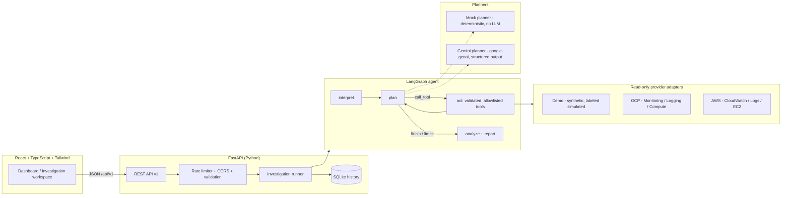

# CloudOps AI Agent

An AI-powered cloud operations platform that investigates infrastructure incidents with evidence — not guesses. A bounded LangGraph agent interprets a question, selects read-only tools, pulls monitoring metrics, logs, and resource metadata from GCP/AWS (or a fully simulated demo environment), correlates what it finds, and returns a structured, evidence-cited incident report.


## What it does

- **Agentic investigation** — a LangGraph workflow with explicit state, a tool allowlist, step/timeout/retry budgets, and a traceable tool-execution timeline.
- **Evidence-based reporting** — every observed fact cites the evidence record (metric series, log query, metadata) it came from. Facts are separated from hypotheses; hypotheses carry likelihoods; the report states confidence and limitations.
- **Multi-cloud, read-only** — provider adapters for GCP (Compute Engine, Cloud Monitoring, Cloud Logging) and AWS (EC2, CloudWatch, CloudWatch Logs). Live access is strictly read-only, allowlist-gated, and fails closed.
- **Demo mode out of the box** — six realistic synthetic incident scenarios (high CPU, memory leak, 5xx spike, deploy regression, storage pressure, EC2 overload) run the complete product with **zero cloud credentials**. All simulated data is labeled as such, everywhere.
- **Professional dashboard** — a minimal monochrome React interface: infrastructure overview, searchable inventory, monitoring charts, investigation workspace with live agent timeline, incident history, and Markdown report export.


## Architecture



Key safety properties:

- The agent can only call four read-only tools (`list_resources`, `get_resource_metadata`, `get_metrics`, `query_logs`). There is no shell, HTTP, IAM, restart, delete, or Terraform capability — by construction, not by prompt.
- Log content is untrusted input: secrets are redacted, prompt-injection patterns are flagged, and anything sent to an LLM is wrapped in explicit untrusted-data delimiters.
- Live cloud mode fails closed: no allowlisted project/account, no credentials → 403, never a silent fallback.

## Quick start (demo mode — no credentials needed)

### Prerequisites
Windows, macOS or Linux; Python 3.11+; Node 20+. (Or just Docker.)

### Option A: Docker

```bash
docker compose up --build
# open http://localhost:8080
```

### Option B: local dev (Windows PowerShell)

```powershell
# Backend
cd backend
py -3.11 -m venv .venv
.\.venv\Scripts\python -m pip install -r requirements-dev.txt
.\.venv\Scripts\python -m uvicorn app.main:app --port 8000

# Frontend (second terminal)
cd frontend
npm install
npm run dev
# open http://localhost:5173
```

Then: **Investigate → pick a demo scenario → Start investigation** and watch the agent's tool timeline, evidence, and report build live. OpenAPI docs at `http://localhost:8000/docs`.

### Optional: Gemini mode with Docker

The stack defaults to the deterministic mock planner (no credentials). To run the agent with Gemini instead:

1. Create `backend/.env` (gitignored — never commit it; see [backend/.env.example](backend/.env.example)):
   ```env
   CLOUDOPS_LLM_PROVIDER=gemini
   CLOUDOPS_GEMINI_API_KEY=<your key>
   CLOUDOPS_GEMINI_MODEL=gemini-3.8-flash
   ```
2. Launch Compose with that file as its environment file:
   ```bash
   docker compose --env-file backend/.env up --build
   ```
3. Verify the active provider (the key itself is never returned):
   ```bash
   curl http://localhost:8080/api/v1/config
   # → "llm": { "provider": "gemini", "model": "gemini-3.8-flash" }
   ```

Only `CLOUDOPS_LLM_PROVIDER`, `CLOUDOPS_GEMINI_API_KEY`, and `CLOUDOPS_GEMINI_MODEL` are forwarded to the backend container. The key never reaches the frontend image, API responses, or logs (regression-tested), and a missing key with `provider=gemini` fails closed. Plain `docker compose up --build` continues to run credential-free demo mode. See [docs/gemini.md](docs/gemini.md) for details.

## Feature status

| Feature | Status |
|---|---|
| Demo environment (6 scenarios), full investigation loop | ✅ Implemented & tested (112 backend + 23 frontend tests) |
| LangGraph agent, bounded tools, deterministic planner | ✅ Implemented & tested |
| Incident history (SQLite), Markdown export | ✅ Implemented & tested |
| Dashboard UI (overview, inventory, monitoring, workspace, history, settings, dark/light) | ✅ Implemented & tested |
| Docker, Compose, GitHub Actions CI | ✅ Implemented (images build locally; CI config ready) |
| Terraform (Cloud Run + read-only IAM) | ✅ Written & `terraform validate` passing — **provisions nothing by default** |
| GCP live adapter (read-only) | 🧪 Implemented & mock-tested — not yet verified against a live project |
| AWS live adapter (read-only) | 🧪 Implemented & mock-tested — not yet verified against a live account |
| Gemini planner (google-genai, structured output) | ✅ Implemented; resilient deterministic fallback **verified against the live API** (a runtime Gemini failure degrades gracefully with honest attribution). Full Gemini-authored runs depend on model availability/latency — see [docs/gemini.md](docs/gemini.md) |
| Multi-user auth / audit trail | 🔭 Planned — see [docs/security.md](docs/security.md) |

## Documentation

| Doc | Contents |
|---|---|
| [docs/API.md](docs/API.md) | REST API contract |
| [docs/agent-architecture.md](docs/agent-architecture.md) | Agent graph, tools, planners, grounding rules |
| [docs/gcp-integration.md](docs/gcp-integration.md) | Read-only GCP setup (ADC, roles, allowlist) |
| [docs/aws-integration.md](docs/aws-integration.md) | Read-only AWS setup (IAM policy, allowlist) |
| [docs/gemini.md](docs/gemini.md) | Enabling the Gemini planner |
| [docs/security.md](docs/security.md) | Security architecture, boundaries, and honest limitations |
| [docs/testing.md](docs/testing.md) | Test suites and how to run them |
| [docs/deployment.md](docs/deployment.md) | Docker, Terraform, Cloud Run deployment, cost notes |
| [docs/portfolio.md](docs/portfolio.md) | Portfolio write-up + LinkedIn description |

## Configuration

All backend configuration is environment-driven (`CLOUDOPS_*`, see [backend/.env.example](backend/.env.example)). Secrets live only on the server; the frontend bundle contains no keys. Demo mode is the default; live GCP/AWS and Gemini are explicit opt-ins with allowlists.

## Tests

```powershell
cd backend;  .\.venv\Scripts\python -m pytest tests -q     # 112 tests
cd frontend; npm test -- --run                             # 23 tests
```

CI runs backend lint+tests, frontend lint+tests+build, Docker image builds, and `terraform validate` on every push/PR.

## License

MIT — see [LICENSE](LICENSE).
