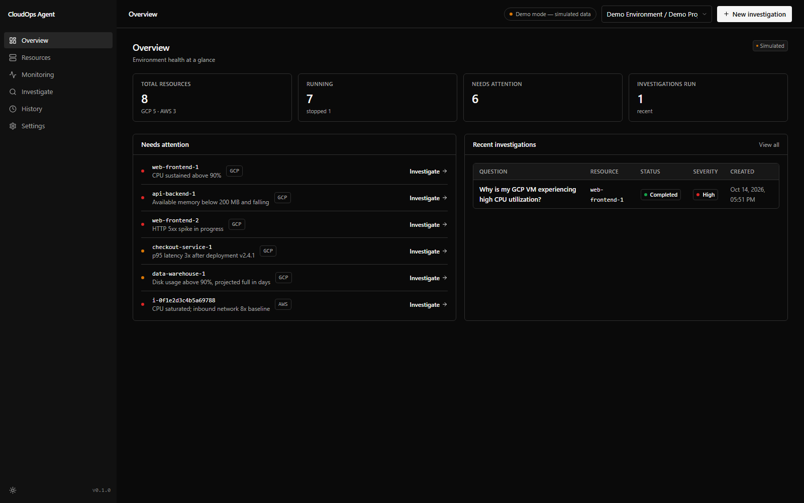
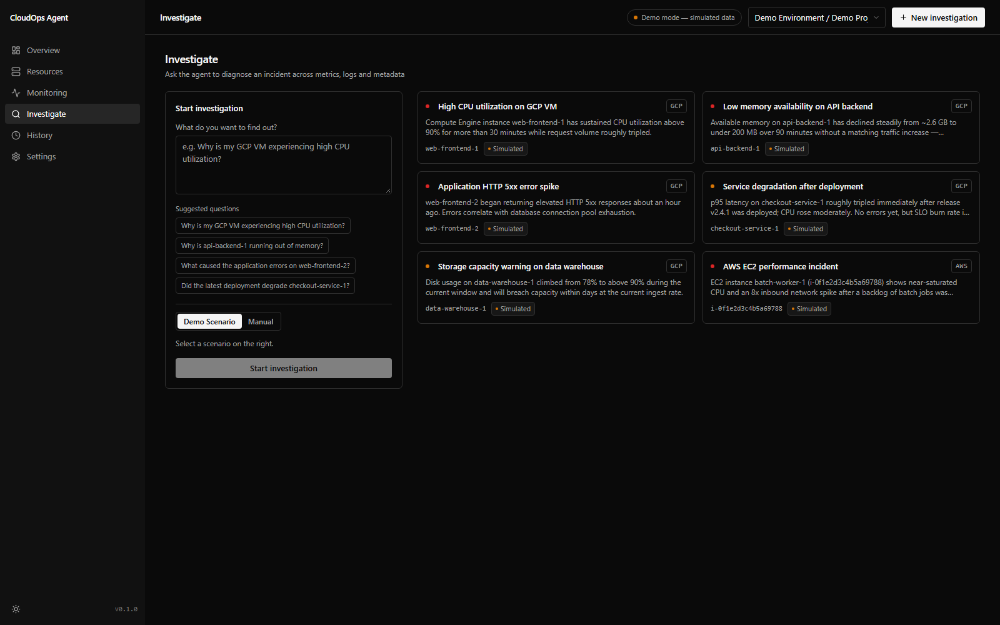
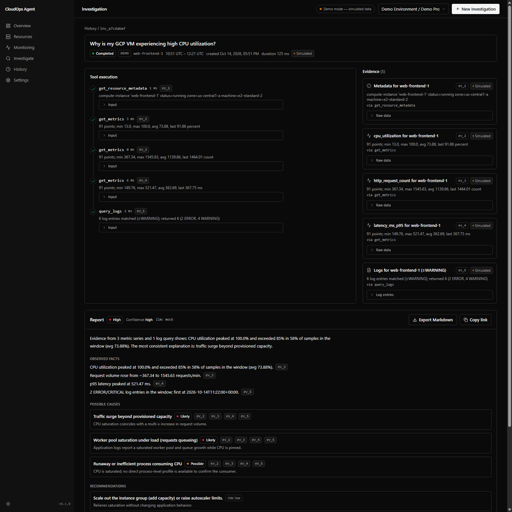
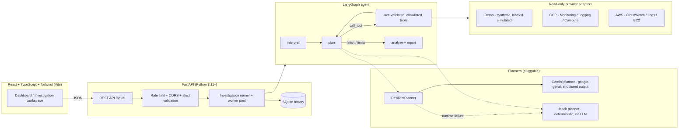

# CloudOps AI Agent

[](https://github.com/annadisandeep/cloudops-ai-agent/actions/workflows/ci.yml)
[](LICENSE)


An AI agent that investigates cloud infrastructure incidents the way a careful SRE does: pull the metrics, read the logs, correlate, and write up findings **with citations**. A bounded [LangGraph](https://github.com/langchain-ai/langgraph) workflow chooses from four strictly read-only tools, collects evidence from GCP/AWS adapters or a built-in simulated environment, and returns a structured report in which every stated fact points at the evidence record it came from.

Built with Python / FastAPI, LangGraph, Google Gemini (structured output via `google-genai`), React + TypeScript + Tailwind, Docker, GitHub Actions and Terraform.

> **Honest status at a glance**
> - Demo mode (simulated telemetry, deterministic planner) is fully implemented and tested: **153 backend + 23 frontend tests pass**.
> - The Gemini planner has been **verified end-to-end against the live Gemini API** (model `gemini-3.5-flash-lite`) on simulated telemetry. [Details below](#verified-live-gemini-run).
> - GCP and AWS live adapters are **implemented and mock-tested, not yet verified against production cloud accounts**.
> - Terraform is `validate`-clean and **provisions nothing by default**. Nothing deploys from CI.

---

## Table of contents

1. [Screenshots](#screenshots)
2. [What it does](#what-it-does)
3. [What is real and what is simulated](#what-is-real-and-what-is-simulated)
4. [Verified live Gemini run](#verified-live-gemini-run)
5. [Architecture](#architecture)
6. [The LangGraph agent workflow](#the-langgraph-agent-workflow)
7. [Safety properties](#safety-properties)
8. [Quick start](#quick-start)
9. [How to demonstrate this project](#how-to-demonstrate-this-project)
10. [Tests and CI](#tests-and-ci)
11. [Feature status](#feature-status)
12. [Project structure](#project-structure)
13. [Documentation](#documentation)

---

## Screenshots

All screenshots are from demo mode (simulated telemetry, clearly labeled) running the deterministic planner.

**Overview dashboard.** Environment health at a glance: inventory counts, resources needing attention, and recent investigations. Note the persistent "Demo mode — simulated data" badge.



**Investigate workspace.** Pick one of six realistic incident scenarios (or ask a free-form question in manual mode) and start the agent.



**Investigation detail.** The agent's tool-execution timeline on the left, the evidence panel on the right, and the final report below. Every observed fact and possible cause carries `ev_N` chips linking back to the raw tool output. The `llm: mock` label in the report header shows this run used the deterministic planner; a Gemini-authored report shows `llm: gemini` in the same place.



---

## What it does

- **Agentic investigation.** A LangGraph state machine (`interpret → plan → act → … → analyze`) with explicit state, a four-tool allowlist, step/timeout/retry budgets, and a persisted tool-execution timeline the UI streams live.
- **Evidence-backed reporting.** Tool calls emit typed Evidence records (`ev_1`, `ev_2`, …). The analyzer computes facts (threshold breaches, trends, error clusters, deploy markers) only from those payloads. Facts are separated from hypotheses, hypotheses carry likelihoods, and the report states its confidence and limitations. With weak evidence it says *insufficient evidence* rather than inventing a cause.
- **Two interchangeable planners.** A deterministic rule-based planner (zero cost, no key, fully tested) and a Gemini planner (`google-genai`, schema-validated structured output). A resilient wrapper degrades a failing Gemini run to the deterministic planner mid-investigation, and the report always names the engine that actually wrote it.
- **Read-only multi-cloud adapters.** GCP (Compute Engine, Cloud Monitoring, Cloud Logging) and AWS (EC2, CloudWatch, CloudWatch Logs). Live access is allowlist-gated and fails closed.
- **Demo mode with zero credentials.** Six synthetic incident scenarios (high CPU, memory leak, HTTP 5xx spike, post-deploy regression, storage pressure, EC2 overload) run the entire product. Every simulated object is labeled `simulated: true` in the API and badged in the UI.
- **Professional dashboard.** Overview, searchable inventory, monitoring charts, investigation workspace, incident history, settings, dark/light theme, and Markdown report export.

---

## What is real and what is simulated

Interviewers rightly ask this first. The table below is the precise answer.

| Component | What actually happens | Verification level |
|---|---|---|
| **Cloud telemetry in demo mode** | Metrics, logs and metadata are **generated deterministically in-process** by `backend/app/demo/data.py`. No cloud account is contacted. Every object is labeled `simulated: true`. | Fully tested (unit, API, real-HTTP end-to-end) |
| **Gemini API calls** | When `CLOUDOPS_LLM_PROVIDER=gemini`, the planner makes **real network calls** to the Gemini Developer API through the official `google-genai` SDK for tool decisions and report prose. | Verified live against `gemini-3.5-flash-lite` on 2026-10-14 (see next section). Mocked in the automated test suite. |
| **GCP live adapter** | Real SDK code (Compute, Monitoring, Logging) with pagination, timeouts and bounded retries. | Implemented and **mock-tested only**. Not yet run against a real GCP project. |
| **AWS live adapter** | Real boto3 code (EC2, CloudWatch, CloudWatch Logs) plus STS caller-identity allowlist check. | Implemented and **mock-tested only**. Not yet run against a real AWS account. |
| **Terraform** | Cloud Run services, Artifact Registry, least-privilege read-only IAM (GCP); read-only IAM policy and role (AWS). | `terraform validate` passes locally and in CI. **Provisions nothing** unless `enable_gcp`/`enable_aws` are set and `apply` is run by hand. |
| **Docker / Compose** | Non-root backend image, unprivileged nginx frontend image proxying `/api/`. | Images build locally and in CI; the Compose stack runs the demo end-to-end. |
| **GitHub Actions** | Lint, test and build both apps, build both images, `terraform fmt`/`validate`. No credentials, no deployment. | Workflow committed at `.github/workflows/ci.yml` and runs on every push/PR. |

In short: **the agent reasoning, the Gemini integration, the API, the UI and the safety controls are real; the cloud data in demo mode is synthetic by design**, so the whole product runs without any cloud credentials.

---

## Verified live Gemini run

On **2026-10-14** the agent was run with `CLOUDOPS_LLM_PROVIDER=gemini` and `CLOUDOPS_GEMINI_MODEL=gemini-3.5-flash-lite` against the live Gemini Developer API, using demo (simulated) telemetry. The resulting investigation records are persisted in the local SQLite history and carry `llm_provider: "gemini"`, which the code sets only when Gemini itself authored the report.

| | Investigation 1 | Investigation 2 |
|---|---|---|
| Question | "rate limit?" (deliberately terse) | "What caused the application errors on web-frontend-2?" |
| Scenario / resource | `gcp-high-cpu` / `web-frontend-1` | `app-5xx-errors` / `web-frontend-2` |
| Tool calls chosen by Gemini | 4: `query_logs` ×3 (scoped to "rate limit", then widening the window and severity), `get_metrics` (`http_5xx_count`) | 1: `query_logs` |
| Evidence records | 4 | 1 |
| Wall-clock | ~10 s | ~6 s |
| Report author | `llm_provider: gemini` | `llm_provider: gemini` |
| Severity / confidence | medium / high | high / high |
| Headline cause | Upstream traffic spike causing worker saturation and load shedding (likely) | Database connection-pool exhaustion and connection-slot saturation (likely) |

Two engineering findings came out of the live runs and are now covered by regression tests:

1. **Gemini rejects open-dictionary JSON schemas.** The Gemini Developer API refuses `additionalProperties` in `response_schema`, so tool arguments now travel as a JSON string (`args_json`) that is parsed and schema-validated locally before any tool runs. A live `503 UNAVAILABLE` from the model at planning step 0 was also observed; the resilient fallback completed that investigation with the deterministic planner (5 tool calls, 5 evidence records) and an honest `api_server_error` limitation, attributed to `mock`, not Gemini.
2. **The model guessed argument names.** `gemini-3.5-flash-lite` sent `start_time`/`end_time` instead of the schema's `start`/`end`. Strict validation (`extra="forbid"`) correctly rejected the calls; the planner prompt now includes exact schema-derived signatures and the rejection message names the offending fields so the model can self-correct on its next step.

What this run does **not** prove: nothing about live GCP/AWS access (the telemetry was simulated), and nothing about Gemini behaviour on other model ids. The default model id in configuration remains `gemini-3.8-flash`; verify any model id against your own API key before relying on it. Full details: [docs/gemini.md](docs/gemini.md).

---

## Architecture



| Layer | Technology | Responsibility |
|---|---|---|
| Frontend | React 18, TypeScript, Tailwind, Vite, hand-rolled SVG charts | Dashboard, investigation workspace with live polling, history, Markdown export |
| API | FastAPI, Pydantic v2 | REST contract (`/api/v1`), validation, error envelope, rate limiting, CORS |
| Agent | LangGraph `StateGraph`, Pydantic tool schemas | Bounded investigation loop, tool execution, evidence generation, report assembly |
| Planners | Deterministic rules; `google-genai` with `response_schema` | Decide the next tool call; write the report prose |
| Providers | Demo generator; `google-cloud-*` SDKs; boto3 | Read-only inventory, metrics, logs, metadata |
| Persistence | SQLite | Incremental investigation state so the UI can stream progress |
| Delivery | Docker, Compose, GitHub Actions, Terraform | Local stack, CI, validation-ready cloud definitions |

---

## The LangGraph agent workflow

The agent is a compiled LangGraph `StateGraph` with four nodes and one bounded loop:

```
interpret ──> plan ──(call_tool)──> act ──> plan …   (≤ max_steps iterations)
                └──(finish | step limit | failure budget)──> analyze ──> END
```

| Node | What it does |
|---|---|
| `interpret` | Normalizes the working state: question, provider, resolved resource id, time window, empty step/evidence lists and counters. |
| `plan` | Asks the configured planner for exactly **one** next action: `call_tool(tool, args)` or `finish`. The planner sees the tool catalog, exact argument signatures, and a sanitized history of previous steps. |
| `act` | Runs the requested tool through the `ToolExecutor`: Pydantic validation (`extra="forbid"`), allowlist check, per-call timeout, bounded transient retry, trace record, Evidence record with a size-capped payload. Results are appended to state and persisted. |
| `analyze` | Builds the final structured report from the collected evidence. The deterministic analyzer always produces the grounded baseline; the Gemini writer may refine prose, and any evidence id it cites that does not exist is stripped. |

**One investigation, step by step**

1. The API validates the request (question length, provider, resource, ≤7-day window) and creates a `running` investigation record.
2. The runner starts the graph in a worker thread with a whole-investigation deadline (default 120 s).
3. `plan` proposes a tool call. Anything outside the four-tool allowlist is rejected before execution and recorded as a failed step.
4. `act` executes it, stores the Evidence record, and the UI's polling picks up the new timeline entry.
5. The loop repeats until the planner says `finish`, the step ceiling (default 8) is reached, or the failed-call budget (3) is exhausted.
6. `analyze` writes the report: summary, observed facts with evidence ids, likelihood-ranked possible causes, safe recommendations with risk levels, confidence, and limitations. The report's `llm_provider` names the engine that actually wrote it.

Bounds are enforced structurally, not by prompt: step ceiling, per-tool timeout, retry budget, failed-call budget, investigation deadline, an application-wide tool-worker pool, and LangGraph's `recursion_limit` as a final backstop. See [docs/agent-architecture.md](docs/agent-architecture.md).

---

## Safety properties

- **Strictly read-only tools.** The agent can call only `list_resources`, `get_resource_metadata`, `get_metrics` and `query_logs`. There is no shell, HTTP, IAM, restart, delete or Terraform capability anywhere in the tool layer, by construction rather than by prompt.
- **Deterministic fallback with honest attribution.** A runtime Gemini failure (5xx, quota, unavailable model, invalid request, malformed structured output, network, timeout) degrades that investigation to the deterministic planner; evidence collection continues under all existing limits. The failure is surfaced in the report's limitations with a sanitized category, and a fallback report is never attributed to Gemini. Missing-key misconfiguration still fails closed.
- **Untrusted telemetry.** Log content is attacker-influenced input: secrets are redacted (AWS/Google/GitHub keys, bearer tokens, labeled passwords, private key blocks), prompt-injection patterns are flagged, and anything sent to an LLM is wrapped in explicit untrusted-data delimiters. The `app-5xx-errors` scenario ships a log line that attempts an injection so the defense is demonstrable.
- **Fail-closed cloud access.** Live providers require an explicit enable flag **and** a non-empty project/account allowlist; AWS additionally verifies the caller account via STS. Anything else returns 403, never a silent fallback to demo data.
- **No secrets near the browser.** All secrets are backend-only `CLOUDOPS_*` environment variables; the API never serializes them and the frontend bundle contains no keys (regression-tested).
- **Hardened delivery.** Non-root backend container, unprivileged nginx frontend with security headers, rate limiting per client IP, parameterized SQL, strict request validation.

Known limitations (no auth or multi-user isolation, heuristic injection detection, in-memory rate limiter) are listed in [docs/security.md](docs/security.md).

---

## Quick start

### Prerequisites

Windows, macOS or Linux. Either **Docker**, or **Python 3.11+** and **Node 20+** (CI uses Python 3.12 and Node 22).

### Option A: Docker (demo mode, no credentials)

```bash
docker compose up --build
# open http://localhost:8080
```

### Option B: local development (Windows PowerShell)

```powershell
# Backend
cd backend
py -3.11 -m venv .venv
.\.venv\Scripts\python -m pip install -r requirements-dev.txt
.\.venv\Scripts\python -m uvicorn app.main:app --port 8000

# Frontend (second terminal)
cd frontend
npm install
npm run dev
# open http://localhost:5173
```

On macOS/Linux replace `py -3.11 -m venv .venv` with `python3 -m venv .venv` and `.\.venv\Scripts\python` with `.venv/bin/python`.

Interactive OpenAPI docs are served at `http://localhost:8000/docs` (local dev) or `http://localhost:8080/api/v1/health` for a quick liveness check on the Docker stack.

### Option C: Gemini mode (real LLM calls, still simulated telemetry)

1. Create an API key in [Google AI Studio](https://aistudio.google.com/).
2. Create `backend/.env` (gitignored, never commit it; see [backend/.env.example](backend/.env.example)):
   ```env
   CLOUDOPS_LLM_PROVIDER=gemini
   CLOUDOPS_GEMINI_API_KEY=<your key>
   # Verified live on 2026-10-14. The configured default is gemini-3.8-flash;
   # confirm whichever id you choose is available to your key.
   CLOUDOPS_GEMINI_MODEL=gemini-3.5-flash-lite
   ```
3. Launch Compose with that file as its environment file:
   ```bash
   docker compose --env-file backend/.env up --build
   ```
   For local dev the backend reads `backend/.env` automatically.
4. Confirm the active provider (the key itself is never returned):
   ```bash
   curl http://localhost:8080/api/v1/config
   # → "llm": { "provider": "gemini", "model": "gemini-3.5-flash-lite" }
   ```

Only `CLOUDOPS_LLM_PROVIDER`, `CLOUDOPS_GEMINI_API_KEY` and `CLOUDOPS_GEMINI_MODEL` are forwarded to the backend container. Plain `docker compose up --build` continues to run credential-free demo mode. See [docs/gemini.md](docs/gemini.md).

### Optional: live GCP / AWS (implemented, mock-tested, unverified against real accounts)

Set `CLOUDOPS_GCP_ENABLED=true` with `CLOUDOPS_GCP_ALLOWED_PROJECTS=<project-id>` and Application Default Credentials, or `CLOUDOPS_AWS_ENABLED=true` with `CLOUDOPS_AWS_ALLOWED_ACCOUNTS=<account-id>` and the standard boto3 credential chain. Required read-only roles and IAM policies are documented in [docs/gcp-integration.md](docs/gcp-integration.md) and [docs/aws-integration.md](docs/aws-integration.md). Treat these paths as unverified until you have run them against your own account.

---

## How to demonstrate this project

A five-minute walkthrough that needs nothing but Docker.

1. **Start the stack.** Run `docker compose up --build` and open `http://localhost:8080`. Point out the "Demo mode — simulated data" badge in the top bar: nothing here touches a real cloud account.
2. **Show the inventory.** Open **Overview** and **Resources**. Eight synthetic resources (5 GCP, 3 AWS), six of them flagged as needing attention. Every card carries a "Simulated" chip.
3. **Run an investigation.** Open **Investigate**, pick **Application HTTP 5xx error spike**, and click **Start investigation**. Watch the tool timeline fill in live: metadata, a few metric series, then a warning/error log query.
4. **Read the evidence trail.** On the detail page, expand an `ev_N` chip under *Observed facts* and show that it opens the raw tool output the fact was computed from. Point out the likelihoods on *Possible causes* and the risk level on each recommendation.
5. **Show the injection defense.** In the same 5xx investigation, open the log evidence: one log line contains a prompt-injection attempt. The report's *Limitations* section flags it, and the agent did not act on it.
6. **Show the safety boundary.** Open **Settings**: GCP and AWS show as disabled with empty allowlists. Explain that enabling them without an allowlist still returns 403 (fail closed), and that the agent has only four read-only tools regardless of what any LLM proposes.
7. **Export the report.** Click **Export Markdown**. A sample export is committed at [sample-data/sample-incident-report.md](sample-data/sample-incident-report.md).
8. **(Optional) Switch to Gemini.** Restart with `docker compose --env-file backend/.env up --build` and a valid key. Run the same scenario; the report header now reads `llm: gemini`. If the model is unavailable, the run still completes and the report says so in *Limitations* with `llm: mock`, which is the fallback behaviour working as designed.

Talking points for interviews: evidence grounding (every fact cites an `ev_N`), structural rather than prompt-based safety, honest attribution when the LLM fails, and the test suite that asserts every cited evidence id exists.

---

## Tests and CI

Current results (run locally on 2026-10-15):

| Suite | Command | Result |
|---|---|---|
| Backend (pytest) | `cd backend; .\.venv\Scripts\python -m pytest tests -q` | **153 passed** in ~25 s |
| Frontend (vitest) | `cd frontend; npm test -- --run` | **23 passed** across 6 files |
| Terraform | `cd infrastructure/terraform; terraform validate` | Success, configuration valid |

Backend coverage by file:

| File | Tests | Covers |
|---|---|---|
| `test_api.py` | 36 | Every endpoint, validation errors, error envelope, pagination/search, log redaction, full investigation lifecycle incl. export, restart persistence, live-mode 403, Gemini missing-key failure, rate limits, injection-flag surfacing, all 6 scenarios complete with causes |
| `test_providers.py` | 25 | Demo adapter filtering/labeling/404s; registry fail-closed matrix; GCP and AWS mapping via mocked clients; STS allowlist rejection |
| `test_security.py` | 18 | Secret redaction, injection detection, delimiter spoofing, length bounds, rate-limiter window math |
| `test_resilient_planner.py` | 17 | Gemini failure before the first tool call, mid-stream failure continuation, report-writer failure, honest attribution, secret redaction in limitations, error-category matrix, `args_json` parsing |
| `test_tools.py` | 15 | Allowlist rejection, schema violations, no-retry on not-found, evidence generation, injection flagging, timeout, transient retry, payload bounding |
| `test_agent_graph.py` | 8 | Every fact cites real evidence, step-limit enforcement, insufficient-evidence path, failed-call budget, planner-crash fallback, disallowed-tool containment |
| `test_gemini_tool_args.py` | 7 | Schema-derived argument signatures in prompts; the live-observed `start_time`/`end_time` mistakes rejected with guidance; persistent bad-args planner bounded by the failed-call budget |
| `test_planner.py` | 7 | Keyword metric routing; Gemini fail-closed without key, disallowed-tool guard, fabricated-evidence-id stripping |
| `test_config.py` | 7 | Default model id, env override, model label, `/config` reflects overrides, Gemini API key never leaks from any endpoint or log |
| `test_demo_data.py` | 7 | Determinism, anomaly presence, healthy baselines, filters, scenario-resource integrity |
| `test_db_and_report.py` | 5 | SQLite roundtrip, upsert, search filters, Markdown rendering |
| `test_e2e_http.py` | 1 | uvicorn on a real socket → create → poll → completed report → Markdown export |

Gemini and the cloud SDKs are **mocked in the automated suite**, so CI needs no credentials. The test session also clears any developer LLM environment variables so a local `backend/.env` can never influence results.

CI (`.github/workflows/ci.yml`) runs on every push and pull request: backend ruff + pytest, frontend eslint + vitest + production build, both Docker image builds, and `terraform fmt -check` + `terraform validate`. No job holds credentials and nothing is deployed. See [docs/testing.md](docs/testing.md).

---

## Feature status

| Feature | Status |
|---|---|
| Demo environment (6 scenarios), full investigation loop | ✅ Implemented and tested (153 backend + 23 frontend tests) |
| LangGraph agent, bounded read-only tools, deterministic planner | ✅ Implemented and tested |
| Gemini planner (`google-genai`, structured output) | ✅ Implemented; **verified live** with `gemini-3.5-flash-lite` on simulated telemetry (2026-10-14) |
| Resilient deterministic fallback with honest attribution | ✅ Implemented and tested; **verified live** against a real `503 UNAVAILABLE` |
| Incident history (SQLite), Markdown export | ✅ Implemented and tested |
| Dashboard UI (overview, inventory, monitoring, workspace, history, settings, dark/light) | ✅ Implemented and tested |
| Docker images, Compose stack, GitHub Actions CI | ✅ Implemented; images build locally and in CI |
| Terraform (Cloud Run + read-only IAM) | ✅ `terraform validate` passes; **provisions nothing by default** |
| GCP live adapter (read-only) | 🧪 Implemented and mock-tested; **not verified against a real project** |
| AWS live adapter (read-only) | 🧪 Implemented and mock-tested; **not verified against a real account** |
| Multi-user auth, audit trail | 🔭 Planned; see [docs/security.md](docs/security.md) |

---

## Project structure

```
cloudops-ai-agent/
├── backend/
│   ├── app/
│   │   ├── agent/        # LangGraph graph, planners, tools, analysis, report, sanitize
│   │   ├── api/          # FastAPI routes (/api/v1)
│   │   ├── demo/         # Deterministic synthetic telemetry (6 scenarios)
│   │   ├── providers/    # Read-only adapters: demo, gcp, aws + fail-closed registry
│   │   ├── config.py     # CLOUDOPS_* settings
│   │   ├── security.py   # Redaction, injection detection, rate limiting
│   │   └── main.py       # App factory
│   ├── tests/            # 153 pytest tests (incl. real-HTTP e2e)
│   ├── Dockerfile
│   └── .env.example
├── frontend/
│   ├── src/              # React + TypeScript pages, components, API client
│   ├── Dockerfile        # Unprivileged nginx serving the build, proxying /api/
│   └── nginx.conf
├── infrastructure/terraform/   # Cloud Run + read-only IAM (disabled by default)
├── docs/                 # Architecture, API, security, integrations, screenshots
├── sample-data/          # Scenario list and a real exported incident report
├── docker-compose.yml
└── .github/workflows/ci.yml
```

---

## Documentation

| Doc | Contents |
|---|---|
| [docs/agent-architecture.md](docs/agent-architecture.md) | Agent graph, tools, planners, grounding rules, injection defenses |
| [docs/API.md](docs/API.md) | REST API contract (`/api/v1`) |
| [docs/gemini.md](docs/gemini.md) | Enabling the Gemini planner, safeguards, fallback behaviour |
| [docs/security.md](docs/security.md) | Security architecture, boundaries and honest limitations |
| [docs/testing.md](docs/testing.md) | Test suites and how to run them |
| [docs/deployment.md](docs/deployment.md) | Docker, Terraform, Cloud Run deployment, cost notes |
| [docs/gcp-integration.md](docs/gcp-integration.md) | Read-only GCP setup (ADC, roles, allowlist) |
| [docs/aws-integration.md](docs/aws-integration.md) | Read-only AWS setup (IAM policy, allowlist) |
| [docs/portfolio.md](docs/portfolio.md) | Portfolio write-up and LinkedIn description |
| [sample-data/README.md](sample-data/README.md) | What the sample data is and how it was produced |

## Configuration

All backend configuration is environment-driven (`CLOUDOPS_*`, documented in [backend/.env.example](backend/.env.example)). Demo mode is the default; live GCP/AWS and Gemini are explicit opt-ins with allowlists. Secrets live only on the server.

## License

MIT. See [LICENSE](LICENSE).
